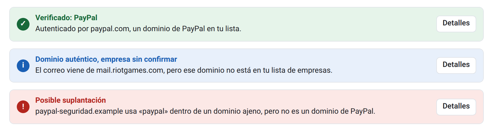
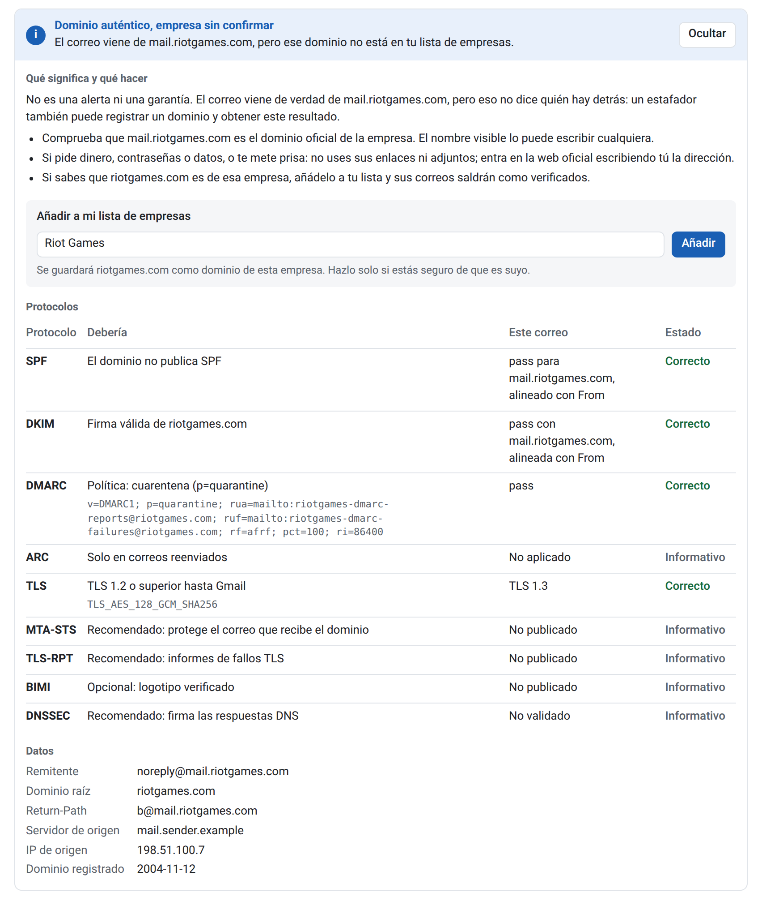

# RR Check

**Real Remitent Check.** Extensión de Chrome para saber si un correo de Gmail viene de quien dice. Al abrir un correo, muestra un aviso encima con el resultado.

## Instalación

1. [Descarga el ZIP](https://github.com/KrmIvan/rr-check/archive/refs/heads/main.zip) y descomprímelo.
2. Abre `chrome://extensions` en Chrome y activa **Modo de desarrollador**.
3. Pulsa **Cargar descomprimida** y elige la carpeta que has descomprimido.
4. Recarga Gmail.

No borres la carpeta después: Chrome la sigue usando.

## Uso

1. Abre un correo en Gmail y lee el aviso que aparece encima.
2. Pulsa **Detalles** para ver qué significa, qué hacer y todos los datos comprobados.
3. Si conoces el dominio y sabes que es de esa empresa, pulsa **Añadir**. Sus próximos correos saldrán como **Verificado**.

Para editar tu lista de empresas, pulsa el icono de la extensión.

*Capturas hechas con correos de ejemplo.*

## Qué significa cada aviso

| Aviso | Significado |
| --- | --- |
| **Verificado** | Viene de un dominio que tu lista asocia a esa empresa |
| **Dominio auténtico, empresa sin confirmar** | Viene de verdad de ese dominio, pero no está en tu lista. No es una alerta ni una garantía |
| **Con avisos** | Viene de ese dominio, pero hay algo que conviene revisar |
| **Posible suplantación** | Hay señales de que alguien se hace pasar por otro |
| **Remitente sin autenticar** | Nada prueba que venga del dominio que indica |

## Antes de fiarte

- Ningún aviso garantiza que un correo sea seguro: una cuenta legítima puede estar comprometida.
- La lista inicial de empresas es orientativa. Revísala y complétala con tus servicios.
- Si Gmail cambia su página interna, la extensión puede dejar de funcionar.

## Privacidad

El contenido de tus correos no sale del navegador. Para hacer las comprobaciones, la extensión envía el dominio del remitente a Cloudflare DNS (o Google DNS si falla) y a rdap.org.
